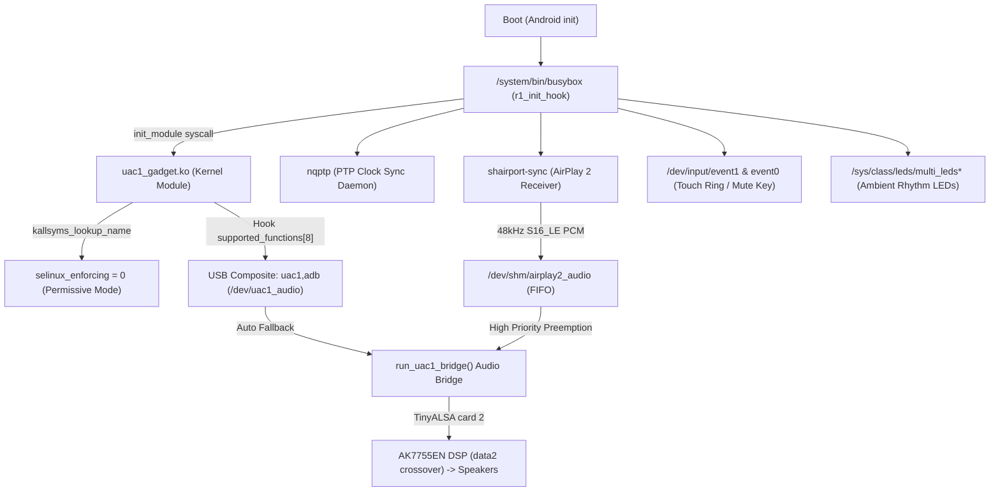

# phicomm-r1-airplay2-uac

[简体中文](README.md) | **English**

An all-in-one open-source firmware enhancement suite for the **Phicomm R1 Smart Speaker (Rockchip RK3229 / Android 5.1 / Linux 3.10)**. Without replacing the stock OS, it turns the R1 into a standalone **AirPlay 2 lossless wireless speaker** and a **driverless USB Audio Class 1.0 (UAC1) wired DAC**, with **kernel-level SELinux bypass**, while 100% preserving the stock **Harman Kardon (AK7755EN) active crossover DSP**, top capacitive touch ring, and music-reactive ambient LEDs.

---

## Table of Contents

- [1. Architecture & How It Works](#1-architecture--how-it-works)
- [2. Flashing & Root / SELinux Bypass Guide](#2-flashing--root--selinux-bypass-guide)
- [3. AirPlay 2 Wireless Streaming Setup](#3-airplay-2-wireless-streaming-setup)
- [4. USB Wired Input (Driverless UAC1 DAC)](#4-usb-wired-input-driverless-uac1-dac)
- [5. Stock Harman DSP, Touch Controls & Ambient LEDs](#5-stock-harman-dsp-touch-controls--ambient-leds)
- [6. Source Code Structure & Build Guide](#6-source-code-structure--build-guide)
- [7. Troubleshooting](#7-troubleshooting)

---

## 1. Architecture & How It Works

This project replaces `/system/bin/busybox` on the eMMC with a compact C daemon (`r1_init_hook`) launched by Android `init` at boot. It loads an embedded kernel module (`uac1_gadget.ko`) directly from memory, supervises `nqptp` and `shairport-sync`, and bridges both AirPlay 2 and USB UAC1 audio to the AK7755EN hardware codec:



---

## 2. Flashing & Root / SELinux Bypass Guide

### 2.1 Prerequisites
- **Supported Device**: Phicomm R1 (RK3229) running stock firmware **3448**.
  - On firmware 3448, `/system/bin/busybox` is located at the fixed eMMC LBA **`0x2b16e8`** (`0x6c6` sectors / `887,808` bytes).
- **Cable**: A **USB Type-A to Type-A male-to-male data cable** connected between your computer and the bottom USB port of the R1.
- **Network & Debug**: Wi-Fi configured on the R1 and ADB debugging enabled with `su` access (or enter Rockchip Loader/Maskrom mode via hardware test-point shorting).

### 2.2 Why Not Modify `boot.img`? (Root & SELinux Mechanism)
1. **U-Boot Signature/Checksum**: Stock Rockchip U-Boot rejects unsigned/modified `boot.img` images and forces the device into Recovery ([build_boot_airplay.py](build_boot_airplay.py) is included for research on boot ramdisk unpacking and SHA1 recalculation).
2. **SELinux Enforcing**: Android 5.1 blocks background sockets, mDNS multicast, and audio hardware access under strict SELinux policies.

**Our Solution**:
- Keep `boot.img` untouched. Flash `r1_uac_firmware_hook.bin` to `/system/bin/busybox` (eMMC LBA `0x2b16e8`) so `init` starts it automatically at boot.
- On startup, `r1_init_hook` calls `syscall(__NR_init_module, ...)` to load the embedded `uac1_gadget.ko`, which locates `selinux_enforcing` via `kallsyms_lookup_name` and sets it to `0` (Permissive) at Ring 0.

### 2.3 One-Click Flash & Deploy

#### macOS / Linux
Run from the project root:
```bash
chmod +x flash_r1_uac.sh
./flash_r1_uac.sh
```
> If multiple Android devices are connected, specify the target serial via `ADB_SERIAL=<serial> ./flash_r1_uac.sh` or `./flash_r1_uac.sh -s <serial>`.

#### Windows
1. **Driver Prerequisites (for flashing only)**:
   - Install Rockchip **DriverAssitant** (for Loader / Maskrom mode) and Android `platform-tools` (`adb.exe`).
   - Place `rkdeveloptool.exe` in the project root (or in your `PATH`).
2. **Option A: One-Click Script (Recommended)**:
   - Double-click [flash_r1_uac.bat](flash_r1_uac.bat) or run in PowerShell:
     ```powershell
     .\flash_r1_uac.ps1
     # With multiple devices: .\flash_r1_uac.ps1 -Serial <serial>
     ```
3. **Option B: Rockchip GUI Tool (`RKDevTool.exe`)**:
   - Reboot the R1 into Loader mode, open `RKDevTool.exe`, and write `r1_uac_firmware_hook.bin` to LBA address **`0x2b16e8`**.
   - For daily USB audio playback on Windows 10/11, the built-in `usbaudio.sys` driver works **plug-and-play without extra audio drivers**.

The script automatically:
1. Reboots the R1 into Rockchip Loader mode via `reboot_loader` (supports `rkdeveloptool-mac` on macOS and `rkdeveloptool` on Linux).
2. Flashes `r1_uac_firmware_hook.bin` to LBA `0x2b16e8` and performs a byte-for-byte readback verification (`cmp`).
3. Reboots the speaker, waits for ADB, and disables obsolete Phicomm cloud services (`com.phicomm.speaker.device` and `com.phicomm.speaker.player`) to eliminate boot voice prompts and reduce idle CPU usage.
4. Pushes `bin/nqptp`, `bin/shairport-sync`, and `bin/shairport-sync.conf` to `/data/local/airplay2/`.

### 2.4 Manual `rkdeveloptool` Commands
```bash
./rkdeveloptool-mac ld
./rkdeveloptool-mac wl 0x2b16e8 r1_uac_firmware_hook.bin
./rkdeveloptool-mac rl 0x2b16e8 0x6c6 verify.bin && cmp r1_uac_firmware_hook.bin verify.bin
./rkdeveloptool-mac rd
```

---

## 3. AirPlay 2 Wireless Streaming Setup

- **Supervisor Threads**: `r1_init_hook` spawns `nqptp_supervisor_thread` (PTP clock sync on UDP 319/320) and `shairport_supervisor_thread` (AirPlay 2 receiver using built-in `tinysvcmdns`), both protected with `oom_score_adj = -1000`.
- **Configuration**: Edit [bin/shairport-sync.conf](bin/shairport-sync.conf) to customize the advertised speaker name (default: **`R1-Music`**). Audio is output as `S16` @ `48000 Hz` into `/dev/shm/airplay2_audio` (512KB FIFO).
- **Usage**: Connect your iPhone / iPad / Mac to the same Wi-Fi network and select **`R1-Music`** in Control Center or any AirPlay-enabled app. Works completely standalone without a PC connected.

---

## 4. USB Wired Input (Driverless UAC1 DAC)

- **Kernel Driver**: [src/uac1_gadget.c](src/uac1_gadget.c) implements a USB Audio Class 1.0 Sink for Linux 3.10, hooking `supported_functions[8]` to expose composite mode **`uac1,adb`** (VID `0x2207`, PID `0x0010`), keeping ADB functional alongside USB audio.
- **Audio Format**: High-Speed / Full-Speed Isochronous OUT (Adaptive), Stereo **16-bit `S16_LE` / 48000 Hz**, streamed via lockless ring buffer `/dev/uac1_audio`.
- **Plug & Play**: Connect via a USB A-A data cable to macOS, Windows, or Linux — recognized automatically as **`Phicomm R1 USB Audio Stream`**.
- **Smart Dual-Mode Switching**: AirPlay 2 preempts USB audio immediately when active (while draining `/dev/uac1_audio` to prevent stalls) and automatically falls back to USB DAC ~2 seconds after AirPlay 2 stops.

---

## 5. Stock Harman DSP, Touch Controls & Ambient LEDs

1. **Harman Kardon AK7755EN Active Crossover**: `init_harman_dsp()` configures `DRAM Size`, `DLRAM Mode`, loads stock `data2` PRAM/CRAM/OFREG firmware, routes `DAC MUX` to `DSP`, and enables `LineOut Amp1/2`.
2. **Capacitive Touch Ring & Center Key**: `/dev/input/event1` adjusts hardware `DAC Digital Volume L/R` (`0–207`); `/dev/input/event0` toggles global mute.
3. **Music-Reactive Ambient LEDs**: `ambient_light_thread` drives `/sys/class/leds/multi_leds0/led_color` and `multi_leds1/led_color` with HSV color cycling and peak-reactive brightness during playback, warm amber on mute, and smooth fade-out on idle.

---

## 6. Source Code Structure & Build Guide

| File / Directory | Description |
| :--- | :--- |
| [src/r1_init_hook.c](src/r1_init_hook.c) | Main init hook & unified AirPlay 2 / USB DAC bridge, DSP, touch, and LED daemon |
| [src/uac1_gadget.c](src/uac1_gadget.c) | Linux 3.10 UAC1 USB gadget kernel module + `selinux_enforcing = 0` patch |
| [src/uac1_gadget_blob.h](src/uac1_gadget_blob.h) | Auto-generated C header embedding `uac1_gadget.ko` |
| [src/airplay_server.c](src/airplay_server.c) | Legacy AirPlay 1 server using stock `libshairport.so` (for reference) |
| [build_gadget.py](build_gadget.py) | Compiles `uac1_gadget.c` into `uac1_gadget.ko` and updates `uac1_gadget_blob.h` |
| [build.sh](build.sh) | Cross-compiles `r1_init_hook.c` and packs `r1_uac_firmware_hook.bin` |
| [build_shairport.sh](build_shairport.sh) | Cross-compilation configure script for static `shairport-sync` |
| [patches/](patches/) | R1-specific patches for upstream `nqptp` and `shairport-sync` |
| [flash_r1_uac.sh](flash_r1_uac.sh) | Cross-platform (macOS/Linux) one-click flash & deploy script |
| [bin/shairport-sync.conf](bin/shairport-sync.conf) | AirPlay 2 configuration file |

### Building from Source
Requires `clang` (targeting `armv7a-linux-gnueabi`), `arm-linux-gnueabihf-ld`, and Python 3:
```bash
python3 build_gadget.py
./build.sh
```

---

## 7. Troubleshooting

1. **AirPlay 2 spinning or silent after switching devices**:
   - Ensure AP isolation and mDNS/PTP multicast filtering are disabled on your router.
   - Check kernel logs via `adb shell dmesg | grep r1_uac` to verify `nqptp` and `shairport-sync` status.
2. **USB audio device not detected on PC**:
   - Verify you are using a **data-capable USB A-A cable** (not a charge-only cable).
   - Check `adb shell ls -l /dev/uac1_audio` and `adb shell cat /sys/class/android_usb/android0/functions` (should output `uac1,adb`).
