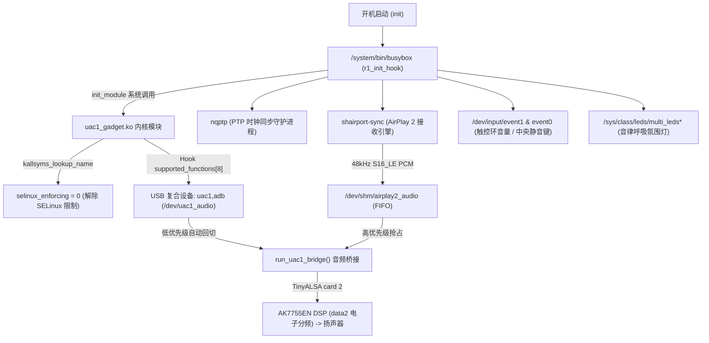

# phicomm-r1-airplay2-uac

**简体中文** | [English](README.en.md)

为**斐讯 R1 智能音箱（Rockchip RK3229 / Android 5.1 / Linux 3.10）**打造的一体化开源固件增强方案：无需拆机换系统，通过极轻量底层 Hook 与内核模块实现 **AirPlay 2 无线无损流媒体**、**蓝牙 A2DP 音箱**、**USB 有线免驱声卡（UAC1，支持电脑端调节硬件音量）** 以及 **内核级 SELinux 穿透（Root 持久化）**，并 100% 保留原厂**哈曼卡顿（AK7755EN）DSP 电子分频调音**、顶部触控滑块与平滑防频闪音律氛围灯。

---

## 目录

- [一、系统架构与工作原理](#一系统架构与工作原理)
- [二、刷机与 Root 权限获取教程](#二刷机与-root-权限获取教程)
- [三、AirPlay 2 无线连接配置教程](#三airplay-2-无线连接配置教程)
- [四、USB 有线输入（UAC1 免驱声卡）教程](#四usb-有线输入uac1-免驱声卡教程)
- [五、原厂 DSP 调音、物理交互与氛围灯](#五原厂-dsp-调音物理交互与氛围灯)
- [六、项目源代码结构与编译指南](#六项目源代码结构与编译指南)
- [七、常见问题排查](#七常见问题排查)

---

## 一、系统架构与工作原理

本项目通过在 eMMC 固化替换 `/system/bin/busybox` 为自定义守护进程 `r1_init_hook`，在开机阶段由 `init` 拉起，并从内存中动态加载自定义内核模块 `uac1_gadget.ko`，同时管理 `nqptp`、`shairport-sync` 与 USB UAC1 音频桥接：



---

## 二、刷机与 Root 权限获取教程

### 1. 适用前提与硬件准备
- **适用设备**：斐讯 R1（RK3229），官方固件版本 **3448**。
  - 在 3448 固件中，`/system/bin/busybox` 在 eMMC 上的绝对起始扇区（LBA）固定为 **`0x2b16e8`**（占用 `0x6c6` 个扇区，即 `887,808` 字节 / 1734 扇区）。
- **连接线材**：一根 **USB A-A 双公头数据线**，连接电脑与 R1 音箱底部的 USB 接口。
- **网络与调试前提**：音箱已配网连接局域网 Wi-Fi，且已开启 ADB 调试并具备 `su` 权限（或可通过短接主板测试点进入 Rockchip Loader/Maskrom 模式直接线刷）。

### 2. Root 与 SELinux 权限机制说明
斐讯 R1 出厂固件运行 Android 5.1（Linux 3.10 内核），在改造过程中存在两层核心限制：
1. **Boot 分区校验限制**：Rockchip U-Boot 会校验原厂 `boot` 分区签名/校验和，直接刷入未签名的修改版 `boot.img` 会导致设备落入 Recovery（仓库内保留了 [build_boot_airplay.py](build_boot_airplay.py) 供研究 `boot.img` 解包与 SHA1 重算）。
2. **SELinux 强制模式限制**：Android 5.1 默认开启 SELinux Enforcing，会拦截守护进程的网络 Socket、多播组播与音频设备访问。

**本项目的无痕固化与提权方案**：
- **不修改 `boot.img`**，而是通过 Rockchip Loader 线刷模式，将编译好的 `r1_uac_firmware_hook.bin` 直接覆盖写入 `/system/bin/busybox` 对应的 eMMC 扇区 `0x2b16e8`，由系统 `init` 进程在开机时自动拉起。
- 在 `r1_init_hook` 启动后，通过 `syscall(__NR_init_module, ...)` 从内存加载内置的 `uac1_gadget.ko` 内核模块。该模块在内核态通过 `kallsyms_lookup_name("selinux_enforcing")` 将 `selinux_enforcing` 置为 `0`（Permissive 模式），彻底解除权限封锁。

### 3. 一键刷入与部署

#### macOS / Linux
在项目根目录执行：
```bash
chmod +x flash_r1_uac.sh
./flash_r1_uac.sh
```
> 若电脑同时连接了多台 Android 设备，可通过环境变量或参数指定目标 R1 序列号：`ADB_SERIAL=<你的设备序列号> ./flash_r1_uac.sh` 或 `./flash_r1_uac.sh -s <你的设备序列号>`。

#### Windows
1. **驱动准备（仅刷机时需要）**：
   - 安装 Rockchip 官方 USB 驱动 **DriverAssitant**（用于识别 Loader / Maskrom 烧录模式）与 Android `platform-tools`（提供 `adb.exe`）。
   - 将 `rkdeveloptool.exe` 放入项目根目录（或加入系统 `PATH`）。
2. **方式 A：一键脚本（推荐）**：
   - 双击运行 [flash_r1_uac.bat](flash_r1_uac.bat)，或在 PowerShell 中执行：
     ```powershell
     .\flash_r1_uac.ps1
     # 多设备时可指定序列号：.\flash_r1_uac.ps1 -Serial <你的设备序列号>
     ```
3. **方式 B：Rockchip 图形化工具（RKDevTool / AndroidTool）**：
   - 若不想使用命令行，可使用 `adb shell su -c '/data/local/tmp/reboot_loader'` 让音箱进入 Loader 模式后，打开 `RKDevTool.exe`，在「下载镜像 / 高级功能」中将 `r1_uac_firmware_hook.bin` 写入偏移地址 **`0x2b16e8`**。
   - 刷入后使用 Windows 10/11 连接 USB 声卡时，系统自带 `usbaudio.sys` **免驱即插即用**，无需安装任何声卡驱动。

脚本会自动完成以下全套工序：
1. **进入 Rockchip Loader 烧录模式**：自动检测设备状态，若未处于烧录模式则通过 ADB 推送 `reboot_loader` 并软重启进入 Loader（支持 macOS `rkdeveloptool-mac` 与 Linux `rkdeveloptool`）。
2. **写入固化镜像并校验**：向 eMMC `0x2b16e8` 写入 `r1_uac_firmware_hook.bin`，随后回读扇区并用 `cmp` 进行 100% 逐字节校验。
3. **精简失效斐讯云服务**：重启后等待 ADB 上线，自动禁用已停服的 `com.phicomm.speaker.device` 与 `com.phicomm.speaker.player`，消除配网失败语音并降低空闲 CPU 占用。
4. **自动部署 AirPlay 2 组件**：自动将 `bin/nqptp`、`bin/shairport-sync` 与 `bin/shairport-sync.conf` 推送至 `/data/local/airplay2/`。

### 4. 手动 `rkdeveloptool` 线刷参考
```bash
./rkdeveloptool-mac ld
./rkdeveloptool-mac wl 0x2b16e8 r1_uac_firmware_hook.bin
./rkdeveloptool-mac rl 0x2b16e8 0x6c6 verify.bin && cmp r1_uac_firmware_hook.bin verify.bin
./rkdeveloptool-mac rd
```

---

## 三、AirPlay 2 无线连接配置教程

### 1. 运行机制
`r1_init_hook` 在后台启动两个带 LMK 免疫（`oom_score_adj = -1000`）的守护线程：
- **`nqptp_supervisor_thread`**：运行 `/data/local/airplay2/nqptp -v`，监听 PTP 时钟端口（UDP 319/320）并维护共享内存时钟同步。
- **`shairport_supervisor_thread`**：等待 2 秒后运行 `/data/local/airplay2/shairport-sync -c /data/local/airplay2/shairport-sync.conf`，通过内置 `tinysvcmdns` 广播 AirPlay 2 服务，并将解码后的 PCM 写入 `/dev/shm/airplay2_audio`（512KB 命名管道）。

### 2. 配置文件说明
配置文件位于 [bin/shairport-sync.conf](bin/shairport-sync.conf)：
```conf
general = {
  name = "R1-Music";           # 苹果设备中显示的音箱名称，可按需修改
  output_backend = "pipe";
  service_type = "airplay2";
  drift_tolerance_in_seconds = 0.050;
  resync_threshold_in_seconds = 1.000;
  audio_backend_buffer_desired_length_in_seconds = 0.50;
  audio_decoded_buffer_desired_length_in_seconds = 2.0;
  default_airplay_volume = 0.0;
  playback_mode = "stereo";
};

pipe = {
  name = "/dev/shm/airplay2_audio";
  output_format = "S16";
  output_rate = 48000;
};
```

### 3. 日常使用与无线保活
- 确保 iPhone / iPad / Mac 与 R1 音箱在同一局域网 Wi-Fi 下。
- 在苹果设备控制中心或音乐 App 的 AirPlay 列表中选择 **`R1-Music`** 即可无线播放，支持拔掉 USB 线脱机独立运行。
- **Wi-Fi 防休眠保活**：内置 `wifi_keepalive_thread` 持续维持 Broadcom `bcmdhd` 唤醒状态（关闭 `PM 2` / `SETSUSPENDMODE 1` 组播过滤），并禁用系统休眠优化，避免息屏后 AirPlay 2 断连或搜不到设备。
- **独立音量**：AirPlay 2 使用独立硬件音量（默认 `180`，可通过顶部触控环或苹果设备滑块调节），不受电脑端 USB 音量调节影响。

---

## 四、USB 有线输入（UAC1 免驱声卡）教程

### 1. 内核级 UAC1 驱动原理
[src/uac1_gadget.c](src/uac1_gadget.c) 实现了针对 Linux 3.10（RK3229）的 **USB Audio Class 1.0 (UAC1) Sink** 驱动，并直接 Hook Android USB Gadget 框架的 `supported_functions[8]`：
- **复合模式 (`uac1,adb`)**：VID `0x2207`、PID `0x0010`，同时保留 **USB 声卡** 与 **ADB 调试口**。
- **音频规格**：High-Speed / Full-Speed Isochronous OUT（Adaptive 同步），立体声 **16-bit `S16_LE` / 48000 Hz**。
- **UAC1 Feature Unit 硬件音量同步**：内置 Master Mute + Volume 控制单元（`-50 dB ~ 0 dB`，`0.5 dB/步` 1:1 对应 AK7755 增益步进），通过 `ioctl 0x5501` 实时同步宿主机音量与静音状态。
- **无锁环形缓冲**：通过字符设备 `/dev/uac1_audio` 低延迟向用户态输出 PCM 数据。

### 2. 使用与双模智能切换
- 使用 **USB A-A 双公头线**连接电脑后，macOS / Windows / Linux 均免驱识别为 **`Phicomm R1 USB Audio Stream`**，可直接使用电脑系统音量键或音量滑块调节硬件音量与静音。
- **AirPlay 2 优先抢占**：AirPlay 2 播放时优先占用声卡并持续排空 USB 缓冲；AirPlay 2 停止超过约 2 秒后，若电脑仍在通过 USB 播放，系统自动无缝回切至 USB 有线声卡模式。

---

## 五、原厂 DSP 调音、蓝牙音箱与氛围灯

1. **原厂哈曼卡顿（AK7755EN）电子分频**：`init_harman_dsp()` 在打开声卡 `mixer_open(2)` 后，自动加载原厂 `data2` 滤波器固件（PRAM / CRAM / OFREG），设置 `DAC MUX` 为 `DSP`，开启高低音双功放 `LineOut Amp1/2`。
2. **蓝牙音箱（A2DP Sink）**：自动维持蓝牙 `Scan Mode: 23` 可发现可连接状态（设备名 `Phicomm_R1_XXXX`）；检测到系统蓝牙音频流进入 `RUNNING` 时自动开启 AK7755 功放解静音，并联动呼吸氛围灯。
3. **顶部环形触控滑块（`/dev/input/event1`）与中央静音键（`/dev/input/event0`）**：顺时针滑动增大音量、逆时针减小音量（0~207 级），短按中央键全局静音/恢复。
4. **平滑防频闪氛围灯**：独立线程 `ambient_light_thread` 以 `120ms` 稳定节拍配合 RGB 死区过滤驱动 `/sys/class/leds/multi_leds0/led_color` 与 `multi_leds1/led_color`，采用柔和饱和度渐变、低通包络与限幅平滑亮度（彻底消除 I2C 刷新频闪），静音呈暖琥珀色，无有效音频输入超过 `1.5s` 自动平滑渐隐熄灭。

---

## 六、项目源代码结构与编译指南

### 1. 源码清单
| 文件 / 目录 | 说明 |
| :--- | :--- |
| [src/r1_init_hook.c](src/r1_init_hook.c) | 核心开机钩子与双模守护进程源码（加载内核模块、AirPlay 2 监管、USB DAC 桥接、DSP、触控与 LED 控制） |
| [src/uac1_gadget.c](src/uac1_gadget.c) | Linux 3.10 内核模块源码（UAC1 驱动、`/dev/uac1_audio`、内核态 `selinux_enforcing = 0`） |
| [src/uac1_gadget_blob.h](src/uac1_gadget_blob.h) | 由 `uac1_gadget.ko` 自动生成的 C 字节数组头文件 |
| [src/airplay_server.c](src/airplay_server.c) | 早期基于原厂 `libshairport.so` 的 AirPlay 1 参考实现 |
| [build_gadget.py](build_gadget.py) | 编译 `uac1_gadget.c` 并更新 `src/uac1_gadget_blob.h` |
| [build.sh](build.sh) | 交叉编译 `r1_init_hook.c` 并打包为 `r1_uac_firmware_hook.bin` |
| [build_shairport.sh](build_shairport.sh) | `shairport-sync` 静态交叉编译配置脚本 |
| [patches/](patches/) | 针对上游 `nqptp` 与 `shairport-sync` 的 R1 适配补丁（`nqptp-r1.patch`、`shairport-sync-r1.patch`） |
| [flash_r1_uac.sh](flash_r1_uac.sh) | 一键线刷与自动化部署脚本 |
| [bin/shairport-sync.conf](bin/shairport-sync.conf) | AirPlay 2 服务端配置文件 |

### 2. 编译命令
需安装 `clang`（支持 `armv7a-linux-gnueabi`）、`arm-linux-gnueabihf-ld` 及 Python 3：
```bash
python3 build_gadget.py
./build.sh
```

---

## 七、常见问题排查

1. **AirPlay 2 偶尔连接转圈或连接后无声**：
   - 确认路由器未开启 AP 隔离或屏蔽 mDNS/PTP 组播包。
   - 通过 `adb shell dmesg | grep r1_uac` 查看内核日志，确认 `nqptp` 与 `shairport-sync` 正常启动。
2. **USB 线连接电脑后未识别声卡**：
   - 确认使用的是**支持数据传输的 USB A-A 双公头线**（非纯充电线）。
   - 执行 `adb shell ls -l /dev/uac1_audio` 与 `adb shell cat /sys/class/android_usb/android0/functions`，确认返回 `uac1,adb`。
